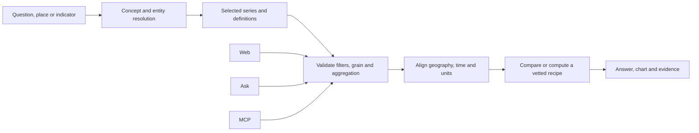

# Public alpha audit: UX, discovery, Ask, MCP and connected data

**11 October 2026 · Local development audit · Prepared for review with Astra**

## 1. Decision and product direction

The latest local app is a substantial improvement over the previous audit. It is close to a useful public alpha for finding and exploring Romanian statistics. Before exposing all capabilities, fix the remaining ways a plausible chart or answer can represent the wrong slice of data. Then make the first successful question much easier to reach.

The strongest product promise is: **find a public-data answer, understand its definition, compare it fairly, and take the evidence away.** More chart types alone will not deliver that promise. Better discovery, consistent query rules and a small set of excellent cross-dataset recipes will.

Recommended launch shape:

- Keep ordinary search, places, dashboards and downloads usable without an account or an LLM key.
- Feature a curated set of roughly ten questions across population, work, prices, tourism and public services. Each should have a reproducible answer and an understandable definition.
- Offer BYOK Ask as an optional assistant after its correctness issues are fixed. Explain how it selects data and which operations it supports.
- Treat public MCP as a separate product surface. The existing development MCP is useful, but its query path needs repair before it can provide trustworthy public answers.
- Keep questionable datasets findable with an explicit quality status; exclude their affected slices from headline answers, derived metrics and correlations until the grain is repaired or an independently verified slice is available.

This is an audit and design proposal. No application fixes, corpus repairs, commits or deployments were performed.

## 2. Scope: the latest local work

The conclusions below concern the local integration and feature work, **not the older deployment at ins.gov2.ro**. Production observations made initially are excluded from the readiness judgment.

| Component | Audited version |
|---|---|
| Main feature worktree | `tempo-structbars`, `feat/structural-bar-toggle`, commit `6a727a2f10b10c0d46e4ae1a5acf2a6ca6d0605c` |
| Included integration | `integ/fix02-fix03`, merge commit `2e6fec2` |
| Browser/API target | Existing local server at `http://127.0.0.1:8093` |
| Corpus | Repaired copy in `tempo-gen-20261005/data/corpus` |
| Corpus generation | `a6737a263a34bf83b69dde1c8a0366f584396d28a78a716f0ce55563fdbdbb90`, built 5 October |
| Report location | Main `tempo-ins-dump` checkout, so it can accompany the existing audit documentation |

Source paths and line numbers below refer to that feature commit. The configured development MCP points at another checkout, so the latest MCP functions were imported from the feature worktree with the repaired corpus explicitly selected. This proves function behavior, rather than a complete external-client MCP session.

Evidence labels used below:

- **Observed:** actual local browser, HTTP or corpus results.
- **Fixture:** controlled local input or delayed responses exercising real code.
- **Source:** verified implementation behavior, without a real provider conversation.
- **Proposal:** future behavior to build and evaluate.

### What is already better

Preserve these gains; do not reopen them as missing features:

- The repaired generation has consistent file registration, canonical-shaped parquets and no served NULL-dimension or high-invalid-time violations under the audit's checks.
- Search indexes the full served catalog, including split datasets. The problem now is relevance and presentation, rather than missing index coverage.
- Grouped REST queries apply the aggregation policy and can explain why a total is unavailable. POP107A's unsafe national sum is withheld on the latest API.
- Indicator-specific measure classification and the source-total work prevent more averages and overlapping categories from appearing as totals. The inspected SAR119E headline is withheld rather than summed indiscriminately.
- Structural category tiles now have bars/grouped/stacked/heatmap choices, with restrictions on which views are offered. Year sliders, playback and sorting within each grain make them more useful.
- Comparison already includes temporal overlays and county scatterplots with Pearson correlation. Related datasets, place profiles, chart-click filtering, per-capita transforms, chart PNG export and URL state also exist.
- Representative latest dataset pages fit a 390px viewport. Ask has bounded requests, provider/model allowlists, key redaction and opt-in persistent key storage.

## 3. Readiness findings and acceptance checks

Priorities indicate the consequence and the surface affected. An unexposed development MCP issue need not block a web-only alpha, but it must block advertising that MCP as a public analytical interface.

| ID | Priority / surface | Finding and evidence | Acceptance check |
|---|---|---|---|
| A01 | P0 · MCP | `tempo_query` bypasses the aggregation policy. On repaired POP107A for 2025 it returns **129,072,774**; the REST query correctly returns `unavailable`, reason `overlapping_levels`, blocking dimension `AGE`. Observed function/API comparison. | Identical query specifications produce the same effective filters, verdict, values and provenance across REST, Ask and MCP, including refusals. |
| A02 | P0 · Ask | An unknown filter is silently ignored. `BOGUS: ["Cluj"]` returns the national population **19,036,031** with `status: ok`, no warnings, and the invalid filter still in the reported aggregation. Observed tool call; no paid model answer was generated. | Unknown columns and malformed filters fail explicitly before execution. The agent can repair the input, but the query never succeeds while ignoring user intent. |
| A03 | P0 · Ask charts | Geographic series are lost. A fixture with Cluj and Iași over two years renders one series, `Value: [20, 21]`, dropping Cluj's `[10, 11]`. `REF_AREA` is explicitly excluded from the grouping role. | Every remaining dimension contributes to series identity. Duplicate chart keys are rejected or represented explicitly; tables and charts preserve the same observations. |
| A04 | P0 · affected data | The repaired copy still contains **160 served files with conflicting observation keys**. Registration and time fixes do not make these grains unique. Observed full audit; this is also in the existing repair queue. | Repair or isolate affected slices. Query metadata exposes the status, and joins, aggregates and correlations refuse conflicting grains. Preserve source evidence rather than arbitrarily deduplicating. |
| A05 | P1 · dashboard | A delayed response can overwrite a newer slider selection. FOM106F shows label/URL **2001** with values from **2000** after rapid changes. Fixture delayed the older actual response by 900ms. | Per-tile request version/cancellation prevents stale rendering. A changed dataset, year, filter or view cannot receive an earlier response. |
| A06 | P1 · comparison | County scatter independently selects each dataset's latest period. A fixture displays `r = 1.00 · 2023 / 2025` without requiring an intentional lag. Constant-axis Pearson returns `0` rather than undefined. | Default to the latest common compatible period; deliberate lag is an explicit setting. Reject incompatible definitions/grains and show constant-series correlation as unavailable. |
| A07 | P1 · Ask discovery | Schema exposes only the first 20 options. AMG157G reports 261 time options but gives the agent only January 2004–August 2005 and `time_range: null`. Source and actual tool result. | Expose actual earliest/latest periods and a paginated/searchable option tool, with explicit truncation. Latest-period and place resolution must work outside the first page. |
| A08 | P1 · MCP sampling | `_sample_parquet` interpolates filter values into SQL literals without escaping. Source finding; no injection was attempted in this audit. | Bind values and paths, validate identifiers/shapes/limits, and return stable errors. Test apostrophes and adversarial literal values on a synthetic fixture. |
| A09 | P1 · navigation | Ask citations point to `/dataset.html`, which returns **404** locally. Both data links and citation links use it. Observed/source. | All citations open the current dataset page with the applicable language and, ideally, the exact query slice. |
| A10 | P1 · mobile | At 320px Ask settings extend from `x=-72` to `248`, clipping the left edge. Dimension Browser hides its entire selector below 640px without a replacement, while telling users to select a dimension on the left. Observed. | Settings are a fitted drawer/dialog; mobile Dimension Browser has an accessible selector. Verify visibility, keyboard interaction and touch targets at 320/390px. |
| A11 | P1 · discovery | Common search phrases often return the wrong concept or a flood of split variants; structural relatedness appears as “100%” even across materially different population definitions. Observed. | Reviewed intent queries rank appropriate indicator families; definition differences and relationship types are visible before selection. |
| A12 | P1 · public discovery | The main v2 dataset page has `robots: noindex`; local `/sitemap.xml` is absent. Observed/source. | Choose canonical public dataset pages, provide meaningful initial HTML and a sitemap, and index those pages deliberately. Do not simply index every filtered URL. |
| A13 | P2 · Ask coherence | Frontend model choices come from `ask-models.json`, while the server publishes another allowlist in `/api/ask/config`. The UI does not use that authoritative list or `enabled` flag. Source. | One configuration determines usable models and hosted/BYOK availability; environment overrides are reflected in the UI. |
| A14 | P2 · trust | The answer checker tests whether numbers occur in any valid tool result, rather than binding claims to metric, place, period and unit. Source. | Use precise wording for current checks; add structured claim references and deterministic derived calculations before claiming semantic verification. |

### Reproductions that matter most

**A01: the semantic rule does not cross every interface.** The same repaired corpus gives opposing results:

```text
Dataset: POP107A
Filters: {"TIME_PERIOD": ["2025"]}
Group by: ["TIME_PERIOD"]

Latest REST: unavailable / overlapping_levels / AGE
Latest MCP tempo_query: SUM = 129072774.0
```

`tools/tempo-dev-mcp/server.py:253` selects AVG for two unit types and SUM otherwise, then calls the query builder directly. This is the highest-value architectural repair: one validated query service should serve every consumer. A deterministic SQL builder does not itself guarantee a statistically meaningful query.

**A02: even a correct national total can be the wrong answer.** The Ask handler accepts:

```json
{
  "matrix_code": "POP105A_judete_grupe",
  "filters": {"TIME_PERIOD": ["2025"], "BOGUS": ["Cluj"]},
  "group_by": ["TIME_PERIOD"]
}
```

It returns the national result while echoing the invalid Cluj filter. The existing REST validator already rejects unknown columns (`app/services/request_validation.py:123`); apply equivalent validation to agent and MCP inputs. This audit did not observe an LLM making that mistake, but it verified that the tool would silently accept it.

**A05: stale chart responses create mislabeled facts.** On FOM106F the ranking was labeled 2001 while “27 Fabricarea echipamentelor electrice” displayed 215, the 2000 value; the 2001 value is 307. `DashboardV2.refreshTile`, `app/static/js/dashboard-v2.js:733`, fetches and renders without checking whether its request is still current. Keep the new controls; add the missing response-order protection.

**A04 is distinct from overlapping categories.** Conflicting grain means multiple source rows share the full exposed dimension key but disagree on value. POP107A's overlapping age/geographic domains are a different problem. Both need guards; solving either does not solve the other.

## 4. Is it discoverable enough?

**For someone who knows TEMPO codes: reasonably. For a first-time citizen, journalist or researcher: not yet.** This is an expert audit judgment; no first-time-user study or search-engine traffic analysis was performed.

### Search: improve intent and families

The full local index works, accent normalization works, and some indicator queries work well. However, the first results often require prior knowledge to recognize the intended concept.

| Query | Latest local result | Product implication |
|---|---|---|
| `POP105A` | Relevant county/region population variants | Code lookup is useful; keep it. |
| `populatie` / `populație` | 69 hits; THC0662 and PSC101B variants lead | Accent handling is consistent, but the familiar population question is poorly served. |
| `populatia` | 281 hits; labor-force population leads | Morphological variants change intent/ranking substantially. |
| `population Cluj` | Broad population/labor-force results, similar to `population` | The place is not turned into an explicit data selection. |
| `salariu mediu net` | Relevant FOM106E/FOM106A splits, 501 hits | Good concept match; group variants into indicator families. |
| `somaj judete` | 1,332 hits; unemployment-benefit measures lead | Broad OR matching and generic geo terms overpower the likely indicator intent. |
| `unemployment county` | ZCL0911 and AMG survey datasets lead | Distinguish registered unemployment from BIM and explain geographic availability. |
| `inflatie` vs `inflation` | RO falls back to name matching; EN uses FTS and ranks IPC101A first | Expand curated concept aliases in both languages. |
| `medici` | One hit, TCW0351 | Ordinary vocabulary is poorly connected to official statistical terminology. |
| `turism innoptari` | Relevant TUR105 variants | A useful starting point for a guided question. |

Broad phrases can have multiple legitimate meanings. Rather than silently picking one, show a short choice such as “resident population” versus “population by domicile,” with a default and definition. For unemployment, make registered versus survey-based unemployment equally explicit.

Improve the existing retrieval pipeline in this order:

1. Curate concept aliases and Romanian morphological forms; weight indicator names and reviewed aliases above broad category/tag matches.
2. Parse geography and time as context: `Cluj`, `județe`, `2023`, `latest`. Show the inferred selection as editable chips.
3. Group split children under an indicator family. Offer geography, frequency, units and age-detail variants inside the result instead of filling the first page with siblings.
4. Show useful selection facts: definition, unit, available geography, actual periods, frequency, quality and why it matches. Move archetype jargon to details.
5. Build a reviewed relevance set from ordinary questions. Optional embedding reranking can follow; it should not be required to repair basic vocabulary and family grouping.

The current 17-question eval measures differences from a baseline. All top sets or ordering changed after corpus/index repairs; some changes are beneficial. Review desired results before accepting new baselines, and score concept selection separately from ordering within a split family.

### Entry points and place discovery

Give the home page three clear ways in: **a question, a place, an indicator**. The shared search exists, but the home experience should make its purpose unmistakable above the headline cards. A useful empty state could offer “Population of Cluj,” “Where are salaries highest?” and “How has inflation changed?” as guided, reproducible flows.

Place pages are a strong bridge between topics. They should answer “what is happening here?” before presenting a long catalog. On the inspected Cluj page, 868 of 997 available datasets fall into “Alte seturi de date.” The implementation groups by accented, human category substrings; source categories often differ. Use stable context/category mappings, normalize the legacy inputs, and support RO/EN labels separately. Add search within a place and carry the place selection into every dataset and comparison.

The related rail needs meaningful descriptions. POP105A, POP106A and POP107A share breakdowns but describe resident population on 1 January, resident population on 1 July, and population by domicile on 1 January. “100%” should not imply full semantic compatibility. Label relationships as “same concept, different date,” “different population definition,” “alternate breakdown,” or “possible denominator.” Show both the reason to connect them and the conditions for comparison.

Group updated datasets by indicator family as well. A cluster of price-index variants should not monopolize a “what's new” area.

### Discovery from the web and AI clients

Choose one canonical dataset URL and preserve old aliases. Render the dataset name, definition, unit, geography, periods and source in initial HTML; add canonical and language metadata, a sitemap, and Dataset structured data. Google documents support for Dataset markup and dataset discovery; inclusion is not guaranteed. [Google Search: Dataset structured data](https://developers.google.com/search/docs/appearance/structured-data/dataset)

The current v2 `noindex` explicitly prevents that page from being indexed. The absence of `/robots.txt` alone does **not** prevent crawling. Keep repetitive filtered/comparison states out of the canonical index as appropriate, while making important dataset, place and topic pages accessible.

`llms.txt` is useful API orientation, but it is not a hosted MCP server. Generate its changing catalog information and document aggregation refusals, pagination, completeness and source definitions. Make REST and MCP examples resolve to the same query contract.

## 5. UX: fewer decisions before a useful answer

### Dataset pages

The new chart controls improve exploration. Now simplify the default reading experience:

- Lead with a short indicator name and a plain definition. Keep the full official title and TEMPO code available for precision.
- Put the selected place, period, unit and population/category basis beside the main result. Separate “latest observation” from “source updated.”
- Give the default chart an explicit question: “How did this change?” or “How do counties compare?” A single-period dataset should not look like a temporal analysis with index/change controls.
- On mobile, show one useful chart first; collapse secondary views. FOM106F's structural tile is roughly 1,500px tall and contains many clipped category labels. Start with a readable top set and an explicit “show all,” while preserving hierarchy/grain boundaries.
- Explain total, component and overlapping groups visually. Sorting within a grain is a useful improvement; visual headings should make those grains understandable.
- Promote share and download for the **current view**, including the selection and transformations. PNG export and URL state already exist; extend provenance consistently rather than rebuilding them.
- When a statistic is unavailable, explain how the user can reach a valid slice. Avoid turning every safety decision into an apparently broken chart.

The per-capita transform also already exists. Its population lookup permits a nearest-year fallback (`dashboard-v2.js:1167`). For new joins and analytical comparisons, show the actual denominator period and population definition; default to an exact alignment, and make fallback an explicit approximation.

### Comparison as a primary workflow

Promote “Compare with…” near the dataset header and in place profiles, not only at the bottom of related cards. Let users choose another indicator, then show a compatibility preview before drawing the result.

The preview should state:

- Which measures and definitions are selected.
- Their common geography, period/frequency and category slice.
- Whether normalization or a unit conversion is required.
- How many areas/periods match and which are excluded.
- Why a comparison is unavailable and what selection would make it work.

Offer two understandable modes: **change over time** and **differences between places**. Keep deliberate lag, normalization and other advanced controls visible in the resulting explanation and URL.

### Accessibility and language

Fix the two confirmed mobile controls first. Then do a focused keyboard and screen-reader audit of search, dialogs, filters, chart controls and data-table alternatives. Contrast, zoom behavior and accessibility conformance were not measured here; do not claim a compliance failure or certification from these screenshots.

Ask and Dimension Browser mix English controls with Romanian content. Translate the complete flow, including empty states and provider errors, and preserve language across citations, place links and comparisons.

## 6. BYOK Ask / the natural-language data tool

### Architecture worth keeping

This is currently closer to **natural language → constrained data tools → deterministic SQL** than unrestricted NL2SQL. The LLM searches, reads schema and proposes filters/grouping; application code constructs queries. That is a good foundation. Keep the SQL boundary and improve the shared semantic contract.

The route has real improvements: validated conversation sizes, provider/model allowlists, request/tool/time/concurrency budgets, redaction, and disclosed key handling. Session storage is the default; persistent storage is optional and clearable. `enabled: false` currently disables hosted-key access while still allowing BYOK; the UI should explain that distinction.

### What is still missing

**Schema and entity resolution.** Twenty leading options are not enough for recent months or thousands of localities. Return actual available period bounds, an option-search tool, explicit total/partition choices, unit scales and quality. Do not make the model guess a value absent from a truncated schema.

**Consistent query validation.** A02 demonstrates that model tools bypass request validation. Also reconsider the automatic removal of Total filters after empty raw queries: a broader successful query may answer a different question. Return a proposed repair or a visibly changed selection. Ask currently permits approximations automatically, while the REST interface makes them opt-in; align that behavior with explicit user intent.

**Multi-dataset capability.** The agent can issue several queries, but the response retains the last query result/chart. It has no typed join or derived-calculation tool. A prose answer referencing several datasets is not yet a reproducible combined analysis.

**Claim verification.** The answer checker is a useful numeric guard, but a number found somewhere in a tool result is not proof that its place, time or definition is correct. It also cannot properly certify newly computed ratios or changes unless the deterministic calculation is itself represented as evidence. Attach structured claim references to result rows or computed outputs; show “source values checked” rather than a stronger verification label until then.

**Real provider validation and cost visibility.** No paid Anthropic, OpenAI or Gemini calls were made. Availability, tool-calling behavior and performance of the configured models remain unverified end to end. Existing call counts bound activity, but there is no actual input/output token accounting or spend budget; tool traces can carry large tables. Add compact result envelopes, usage reporting and measured provider smoke/eval runs before recommending models to alpha users.

### Better Ask interaction

For an ambiguous question, show a small plan before the result: “Resident population · Cluj · latest available year · total population.” Let the user change it. For clear questions, the plan can be shown with the answer rather than adding an approval step.

Render the answer as a small evidence card: value or finding, chart/table, definition, source, exact filters, period and method. Add useful follow-ups that operate on the same query specification: “compare counties,” “show ten years,” “per 1,000 residents,” “compare with tourism.” Preserve the structured selection across conversation turns.

Before asking for a key, offer a working guided example and a direct path to the same data manually. Keep key setup to one fitted panel, use server-advertised model choices, and provide clear authentication/rate-limit messages. Show useful progress such as searching/selecting/querying, plus cancellation where cancellation can actually stop work.

Evaluate the whole task, not merely the final text: selected indicator, geography, period, valid aggregation, exact values, chart grain, citation target and appropriate refusal. Include ambiguous population/unemployment questions, unknown columns, recent monthly values, empty slices, overlapping age bands and valid derived calculations.

## 7. MCP: turn the internal toolset into a dependable data interface

The existing MCP is a stdio development server with 14 introspection/evaluation tools. It is not currently a remotely hosted public MCP endpoint. That is a scope distinction, not a defect in using stdio for development.

Its useful shared pieces are search and metadata. Its query/sampling paths remain inconsistent with the repaired app. Other development tools expose paths, logs and internal endpoint calling, which are useful to maintainers but unnecessary in a public catalog.

For a first public data MCP, offer a small read-only surface:

| Tool | Purpose |
|---|---|
| `search_indicators` | Find indicator families with concept, geography and frequency context. |
| `describe_dataset` | Definition, actual coverage, unit/scale, valid levels, quality and query examples. |
| `search_dimension_values` | Resolve places, dates and categories with pagination and stable identifiers. |
| `query_series` | Execute a typed, bounded query through the same policy used by REST and Ask. |
| `list_places` | Resolve geographic identities and parent relationships. |

Add `compare_series` and vetted `compute_indicator` recipes after the shared analysis contract exists. Use structured argument objects rather than JSON encoded inside strings. Return structured data with an output schema, stable errors, completeness/truncation information and provenance. MCP defines structured tool results and output schemas; read-only annotations are useful client hints, not enforcement. [MCP tools specification](https://modelcontextprotocol.io/specification/2025-11-25/server/tools)

Keep internal endpoint callers, pipeline logs and eval tools in the development server. A public data tool should not invoke the paid Ask route as a side effect. Users' own AI clients can supply the language model; querying a read-only data MCP need not send their model key to this application.

For remote access, use the transport supported by the chosen SDK/protocol version, validate origins and apply deliberate resource limits. The referenced MCP specification distinguishes stdio from Streamable HTTP and describes HTTP origin validation/authentication considerations. Pin the version and test actual clients rather than treating `/llms.txt` or a REST URL as an MCP connection. [MCP transports specification](https://modelcontextprotocol.io/specification/2025-11-25/basic/transports)

Publish a short connection guide and a tested question such as “Give me resident population in Cluj for the latest available year, with its definition and source.” The answer should match the web app exactly.

## 8. Connecting data: build a shared series contract

The existing metadata, SDMX concepts, parsed dimensions, verified levels and query builder provide a useful substrate. A graph database or an LLM-generated SQL join is not a prerequisite.

Add a small indicator/series registry that describes meaning and compatibility, then use it for discovery, comparisons, recipes, Ask and MCP.



### Minimum contract

| Aspect | Required information / rule |
|---|---|
| Measure | Concept and definition, source dataset, selected population/category universe, stock/flow/rate/mean/index semantics. |
| Geography | Stable identity and level, code-system/version mapping, boundary validity. Locality SIRUTA mappings already exist; county joins currently rely heavily on names. |
| Time | Actual available periods, frequency, start/end or reference date, observation period versus publication date, stock reference dates and explicit lag. |
| Units | Unit and multiplier, currency and denomination, nominal/real price basis, index base, conversion provenance. Generic `currency` or `count` is insufficient. |
| Categories | Explicit sex/age/residence/activity selections, verified disjoint levels, hierarchy, total rows and weights where needed. |
| Quality | Unique exposed grain, conflicting-key status, source/partition verification, missingness, revisions and generation identity. |
| Derived result | Formula, source query specs, denominator definition, matching/excluded rows, transformations, rounding and complete lineage. |

Compile a series request into a validated slice **before** joining. Reduce each source to a unique key such as `(geo_id, period)` using an allowed aggregation. Assert one-to-one cardinality; do not join raw observations and hope that a later SUM fixes a many-to-many expansion.

Default to compatible common periods and matched geography. Show exclusion counts and unmatched identities. Never fill missing statistical observations with zero silently. Temporal resampling needs measure-specific rules: an annual flow, average salary, stock and price index cannot all be handled by the same AVG or SUM.

The present per-capita feature should become a consumer of this contract. Record the denominator population basis and year. If a recipe uses resident population for a numerator defined by domicile, make that mismatch a conscious analytical choice rather than an invisible lookup.

A useful relationship graph can connect concepts, series, places, categories, denominators and recipes. Its first product output should be contextual suggestions such as “normalize this by population” or “same indicator at regional level,” not a large graph visualization that requires users to understand the metadata model.

## 9. Capability ideas: six compelling recipes

These are proposed pilots, not verified combined indicators. Validate the named candidate datasets' definitions, quality and available slices before calculating or publishing a recipe.

| Recipe | Why a user cares | Candidate data / validation requirement |
|---|---|---|
| **Tourism intensity** | Which counties have the most overnight stays relative to population? | TUR105 family + resident population. Show stays per resident as an intensity measure, not the percentage of residents traveling. Match period, geography and denominator. |
| **Births, deaths and population change** | Is a county shrinking because deaths exceed births, and how does the population stock change? | POP201/POP206 and POP105 families. Align definitions and stock dates. A residual is not automatically net migration; revisions and different populations can contribute. |
| **Salary purchasing power** | Did salary growth outpace prices? | FOM106 and IPC101 candidates. Select the correct salary statistic, chain the appropriate price index and align periods; disclose that national CPI is used if there is no local price measure. |
| **Health capacity and aging** | How does capacity compare with population size and age structure? | Hospital beds/medical personnel plus population. Distinguish establishment location from population served, and public/private or specialty scope. |
| **Education capacity and cohort demand** | Where do child populations and education resources diverge? | Age-specific population, pupils, schools and teaching staff. Match school-year/calendar-year meaning and school location versus residence. |
| **Housing and demographic pressure** | Where are completions increasing relative to population change? | Housing completions and population. Locality/county split grain is a prerequisite; affected LOC108B slices must pass the conflicting-key check first. |

My first choice is **tourism intensity**, followed by **salary versus prices**. They tell understandable stories and demonstrate genuine combination. A population-definition explainer is a valuable companion because it establishes how the product handles apparently similar but different statistics.

Add a small “analysis basket” so users can retain two or three selected series and see compatibility. It can begin as shareable URL state without accounts. Each recipe should export its results plus metadata/query specification; a chart alone is insufficient for a journalist or researcher to reuse the analysis.

Other worthwhile follow-ups: county-to-locality drill-down using existing nesting/SIRUTA data; comparison with regional/national baselines; explicit seasonal and real-price transformations; revision/change notifications for saved analyses; and compatible Eurostat data after the internal identity/units contract works. Avoid adding external providers before the existing joins are dependable.

## 10. Correlations: develop the existing compare page carefully

There is already a working county scatterplot. The inspected population comparison produced 42 matched areas, `r ≈ 0.99`, for 2025. This demonstrates the machinery, but related population counts are not a compelling discovery by themselves. A plausible explanation is that larger counties are large on both definitions; this is an inference, not a causal finding.

A useful alpha correlation experience should:

1. Validate unique series, compatible geography and an explicitly selected common period before calculating.
2. Show a scatterplot, readable measure names/units, matched sample size, missing/excluded areas and the selected slices.
3. Explain raw counts versus intensity/rates. Offer normalization when substantively justified, using a disclosed denominator.
4. Return “undefined” for constant series. Offer Pearson for linear association and, later, Spearman for ranks; do not label every association a discovery.
5. Label association as association. Scatterplots help reveal outliers, nonlinearity and other patterns; they do not establish causation. [NIST: Scatter plot](https://itl.nist.gov/div898/handbook/eda/section3/eda33q.htm)
6. Make sensitivity checks visible and intentional, for example inspecting the result with/without Bucharest. Do not silently remove unusual counties.
7. Keep a cross-sectional county comparison separate from a time-series analysis. Shared trends and serial dependence make temporal correlations a different problem; pooling every county-year as an independent observation is also misleading.

After alpha, add explicit lag, trend/difference views and transparent exploration of multiple candidate pairs. If the product searches many correlations, record how many pairs were tested and address multiple comparisons before offering significance claims. Start with curated pairs and explanations rather than an automated “surprising correlations” feed.

## 11. Suggested implementation order

### Wave 1 — make public answers consistent

Unify query validation and aggregation outcomes across REST/Ask/MCP; repair Ask series identity; fix slider response ordering and citation targets; align comparison periods; gate conflicting-grain data; repair mobile settings and dimension selection. Preserve the current corpus generation and existing numerical fixtures.

Deliverable: the same selected question produces the same slice and result through every exposed interface, with useful refusals where necessary.

### Wave 2 — make the first successful question easy

Curated concept aliases, place/time extraction, indicator-family results, reliable actual period bounds and option search, corrected place themes, guided questions, a visible comparison entry point, and canonical public pages. Make Ask model/configuration choices consistent and run measured provider tasks.

Deliverable: a first-time visitor can find and understand an answer without knowing a TEMPO code or supplying an API key.

### Wave 3 — demonstrate connected analysis

Introduce the series contract, compatibility preview and deterministic recipe execution. Ship tourism intensity and salary purchasing power, then extend the existing scatterplot with normalization and explicit exclusions. Expose the same operations through the public MCP.

Deliverable: a shareable multi-source answer whose calculations and selections another person can reproduce.

### Public-alpha exit checks

- No exposed query silently ignores a requested column or displays an earlier response under a newer selection.
- Bad/overlapping/conflicting slices produce an explicit quality decision through every surface.
- The curated questions have reviewed indicator definitions, expected slices and numerical answers, including latest-period lookup and ordinary RO/EN phrasing.
- Ask chart values, source links and answer claims agree with the result specification; each advertised provider passes real tool-calling smoke/eval tasks.
- Comparison uses intentional periods, compatible grains and visible matching/exclusion counts; undefined correlations remain unavailable.
- First-time usability sessions cover finding a county answer, explaining its definition, comparing it and sharing/downloading it. Track success and confusion rather than treating clicks alone as success.
- Smoke the actual staged release image with the intended generation, FTS, representative exports and constrained concurrency. Local functional tests do not establish behavior on the deployment's smaller resource budget.

These are proposed acceptance checks, not claims that a new release was packaged or validated during this audit.

## 12. Questions for Astra

The most useful second review would challenge the priorities and the semantic contract, rather than repeat the old production audit.

1. Is the shared query boundary sufficient to prevent different answers across REST, Ask and MCP? Where should source totals, grain and period-specific checks live?
2. Which existing safeguards remain too permissive for sums, stacked charts and nearest-year normalization? Do the new category-view guards cover all chart paths?
3. What is the smallest series/compatibility model that supports two safe recipes without creating a second metadata system?
4. Would tourism intensity and salary purchasing power create the best first “this is useful” moments, or are other pairs easier to validate?
5. Can discovery reach good concept selection with curated aliases, entity extraction and family grouping before adding embeddings?
6. How should Ask bind a statement to a result row or deterministic calculation, and how should that evidence persist through conversation turns?
7. Which conflicting-grain slices can be isolated for alpha, and which require pipeline repair before any analytical use?
8. What can be cut from the launch scope without weakening the central promise?

Suggested handoff prompt:

> Review this local public-alpha audit critically against commit `6a727a2` and repaired generation `a6737a263a34`. Do not assess the older ins.gov2.ro deployment as the current implementation. Verify the reproduced findings, challenge the launch blockers and propose the smallest coherent plan for discoverability, BYOK Ask, public MCP and two safe cross-dataset recipes. Preserve existing chart controls, comparison, per-capita transforms and aggregation safeguards. Identify missing semantic checks and give concrete acceptance criteria. Treat proposed recipes as unvalidated until their definitions, periods, units and grains are checked.

## 13. Validation, evidence and limits

Latest feature worktree: **462 tests passed, 29 skipped** in the ordinary run. A separate read-only corpus-marked run against the repaired generation passed **23 tests**; 468 others were deselected. Earlier main-checkout results are not used to claim feature readiness.

The read-only repaired-corpus audit found 4,110 readable/registered files: 1,185 served canonical parents, 2,191 registered splits and 734 noncanonical parents. There are no missing file/metadata registrations or row-count mismatches under its checks. All 3,376 served datasets have dimension-structure, value-profile and trend entries; one lacks a matrix/view profile (`ART124A`). Coverage metadata still covers only 1,225 served datasets, reflecting the known legacy-only profiler. Structure-table presence alone does not prove an additive partition, and “no high-invalid-time violation” does not mean every period value is valid.

Conflicting full-key values occur in 174 files overall, **160 served**. Do not count noncanonical parents as additional served defects. A compact evidence file accompanies this report, including the affected served codes and actual tool outputs.

Chart-selector eval: 1,986 baseline datasets, 4,110 current; 39 primary changes, 143 top-set changes and 2,124 additions. Search eval: 17 questions, 13 top-set changes and 4 order changes. These match the repaired-generation review context; baselines were not rebuilt. They are regression evidence, not proof that every chart or search result is correct.

Browser inspection covered latest representative dataset, comparison, place, Ask and Dimension Browser flows, plus targeted chart/period fixtures. Representative page loads had no observed console/network failures; fixture-driven defects are stated separately. There was no paid LLM call, actual external-client MCP certification, source re-fetch, load test, formal accessibility audit, user study or production deployment.

Important source locations at the audited feature commit:

| Area | Source |
|---|---|
| MCP aggregation and sampling | `tools/tempo-dev-mcp/server.py:253`, `:1046` |
| Ask schema/query tools and last-result handling | `app/services/agent.py:193`, `:230`, `:440` |
| Query validation | `app/services/request_validation.py:123` |
| Numeric answer checking | `app/services/answer_check.py`, `_matches` / `uncited_numbers` |
| Ask citations and chart roles | `app/static/js/ask.js:244`, `:305`, `:420` |
| Slider refresh and per-capita fallback | `app/static/js/dashboard-v2.js:733`, `:1167` |
| Comparison identity/period selection and Pearson | `app/static/js/compare.js`, `geoSlice` / `renderScatter` / `pearson` |
| Place theme matching | `app/static/js/place-page.js:389` |
| Mobile dimension selector | `app/static/dimensions-explorer.html:177` |
| Search indexing policy | `app/static/dataset-v2.html:9` |

Companion: [compact local evidence](2026-10-11-public-alpha-evidence.json). Existing remediation context: [FIX packages](../fixes/README.md), [backlog](../BACKLOG.md), [activity history](../activity-history.md).
